

  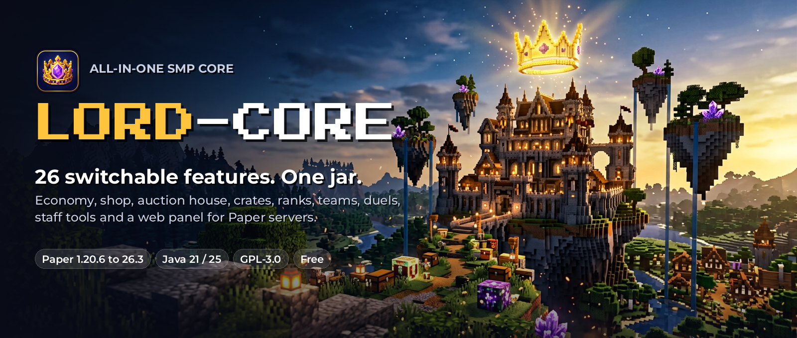

  
  
  
  

  <a href="#install">Install</a> ·
  <a href="#features">Features</a> ·
  <a href="#web-panel">Web panel</a> ·
  <a href="docs/COMMANDS.md">Commands</a> ·
  <a href="docs/PERMISSIONS.md">Permissions</a>

---

**Lord-Core** is one plugin that covers what a survival (SMP) server normally needs a dozen plugins for: economy, shop, auction house, crates, ranks, teams, duels, staff tools and a web panel. It has 26 features, and each one can be switched on or off while the server runs. A feature that is off loads no code and registers no commands.

- **One jar, one database.** Everything is stored in a single SQLite file; each feature keeps its settings in its own folder.
- **Edit in game.** The shop, crates, ranks, menus, sidebar and every setting have an editor screen. No file editing is needed for day-to-day changes.
- **Edit from a browser.** The built-in web panel works through a free Cloudflare tunnel: no port forwarding, no account.
- **Free and open source** under the GPL-3.0.

 

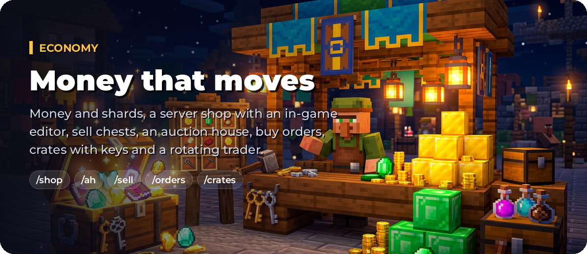

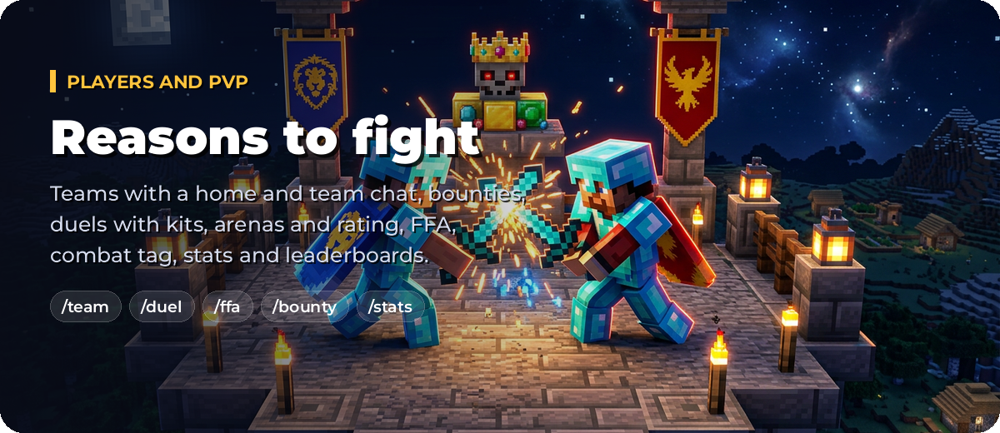

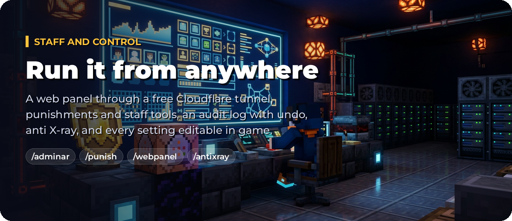

> The three pictures above and the banner are AI-generated artwork. The web panel pictures further down are real screenshots.

## Install

1. Download the jar made for your Minecraft version from the table below.
2. Put it in the `plugins` folder of your **Paper** server and restart.
3. Join as an operator and type **`/adminar`**. Open *Features* and switch on what you want.

| Minecraft | Download | Java | Tested with |
|---|---|---|---|
| **1.21.11** | [LordCore-0.22.0-mc1.21.11.jar](https://github.com/hackerlemonaru/Lord-Core/releases/download/v0.22.0-mc1.21.11/LordCore-0.22.0-mc1.21.11.jar) | 21 | in-game bots and console |
| **26.2** | [LordCore-0.22.0-mc26.2.jar](https://github.com/hackerlemonaru/Lord-Core/releases/download/v0.22.0-mc26.2/LordCore-0.22.0-mc26.2.jar) | 25 | console |
| **26.3** | [LordCore-0.22.0-mc26.3.jar](https://github.com/hackerlemonaru/Lord-Core/releases/download/mc26.3-v0.22.0/LordCore-0.22.0-mc26.3.jar) | 25 | console |
| **26.1.2** | [LordCore-0.22.0-mc26.1.2.jar](https://github.com/hackerlemonaru/Lord-Core/releases/download/mc26.1.2-v0.22.0/LordCore-0.22.0-mc26.1.2.jar) | 25 | in-game bots and console |
| **1.21.10** | [LordCore-0.22.0-mc1.21.10.jar](https://github.com/hackerlemonaru/Lord-Core/releases/download/mc1.21.10-v0.22.0/LordCore-0.22.0-mc1.21.10.jar) | 21 | in-game bots and console |
| **1.21.8** | [LordCore-0.22.0-mc1.21.8.jar](https://github.com/hackerlemonaru/Lord-Core/releases/download/mc1.21.8-v0.22.0/LordCore-0.22.0-mc1.21.8.jar) | 21 | in-game bots and console |
| **1.21.4** | [LordCore-0.22.0-mc1.21.4.jar](https://github.com/hackerlemonaru/Lord-Core/releases/download/mc1.21.4-v0.22.0/LordCore-0.22.0-mc1.21.4.jar) | 21 | in-game bots and console |
| **1.21.1** | [LordCore-0.22.0-mc1.21.1.jar](https://github.com/hackerlemonaru/Lord-Core/releases/download/mc1.21.1-v0.22.0/LordCore-0.22.0-mc1.21.1.jar) | 21 | in-game bots and console |
| **1.20.6** | [LordCore-0.22.0-mc1.20.6.jar](https://github.com/hackerlemonaru/Lord-Core/releases/download/mc1.20.6-v0.22.0/LordCore-0.22.0-mc1.20.6.jar) | 21 | in-game bots and console |

Each jar is built against the Paper API of its own version and tested on a Paper server of that version. What the tests cover is described in [docs/VERSIONS.md](docs/VERSIONS.md). For a version between two rows (for example 1.21.5), use the jar of the nearest lower row; that combination is not tested.

Six features are on after the first start (economy, sell, shop, teleport, settings, scoreboard). The rest are one click away.

**Optional plugins**, used when present: [Vault](https://www.spigotmc.org/resources/vault.34315/) (so other plugins can use Lord-Core money), PlaceholderAPI, LuckPerms and [PacketEvents](https://modrinth.com/plugin/packetevents).

Lord-Core needs Paper. It does not run on Spigot, Fabric or Forge, and not on Minecraft 1.20.4 or older.

## Features

| Feature | Id | What it adds | First start |
|---|---|---|---|
| **Economy** | `economy` | Money and shards ledger, /bal, /pay, /baltop, /eco, Vault support. | on |
| **Sell & Worth** | `sell` | /sell chest, /sellhand, /sellall, /worth, sell history, sell multiplier. | on |
| **Shop** | `shop` | Server shop with categories, and the in-game /shop edit editor. | on |
| **Teleport & Homes** | `teleport` | /spawn, /home, /sethome, /tpa, /tpahere, /rtp with a warm-up. | on |
| **Settings** | `settings` | Per-player /settings menu. Other modules add their choices to it. | on |
| **Scoreboard & Tab** | `scoreboard` | Sidebar, tab header and footer, /sidebar. | on |
| **Auction House** | `auction` | /ah player market: list, search, sort, buy, collect unsold items. | off |
| **Orders** | `orders` | /orders and /order: buy orders paid up front, delivered in parts. | off |
| **Shards & AFK** | `shards` | /afk zone that pays shards over time. Spend them in the shop. | off |
| **Spawners** | `spawners` | Stackable spawners that make loot instead of mobs, with a rules menu. | off |
| **Crates & Keyall** | `crates` | /crates with virtual keys, /key, and a keyall timer. | off |
| **Ranks** | `ranks` | Your own ranks: prefix, chat format, permissions and perk limits. None pre-made. | off |
| **Playtime Rewards** | `playtime` | /playtime and /rewards: milestone and repeating rewards. | off |
| **Worth on Hover** | `worthhover` | Shows what an item sells for in its tooltip. Needs the PacketEvents plugin. | off |
| **Teams** | `teams` | /team: invite, team chat, team home, friendly fire switch. | off |
| **Bounties** | `bounties` | /bounty puts money on a player; the killer collects it. | off |
| **Friends & Messages** | `social` | /msg, /r, /ignore, /friend with a friends screen. | off |
| **Stats & Leaderboards** | `stats` | /stats and /leaderboard: kills, deaths, streaks, playtime, money. | off |
| **Combat Tag** | `combat` | Combat tag: blocked commands and logout counts as death. | off |
| **Punishments and staff tools** | `punishments` | /punish, bans, mutes, history, vanish, freeze, reports. | off |
| **Amethyst tools** | `amethyst` | /amethyst: timed special tools for shards, 3x3 mining. | off |
| **Billford** | `billford` | /billford: a trader whose goods change every few hours. | off |
| **Duels and FFA** | `duels` | /duel with kits, arenas, queue and rating; /ffa. | off |
| **Web panel** | `cloudflare` | A web page with console, players and controls, through a free Cloudflare tunnel. | off |
| **Anti X-ray** | `antixray` | Hides ores from X-ray users with Paper's own engine. Level 1 or 2, per world. Needs one restart to start or stop. | off |
| **Network** | `network` | Links servers through Redis: balances, punishments, staff chat, messages. | off |

More detail: [docs/FEATURES.md](docs/FEATURES.md) · admin commands: [docs/COMMANDS.md](docs/COMMANDS.md) · permissions: [docs/PERMISSIONS.md](docs/PERMISSIONS.md)

## Web panel

Switch on the *Web panel* feature and the console prints a private link. Open it on a computer or a phone.

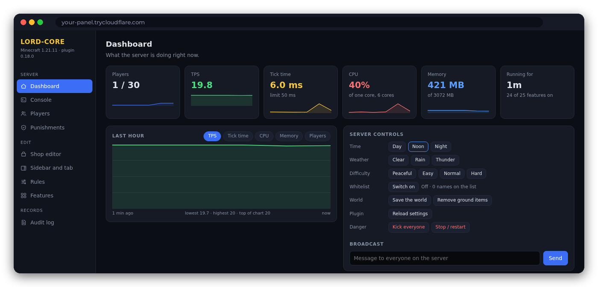

| | |
|---|---|
| 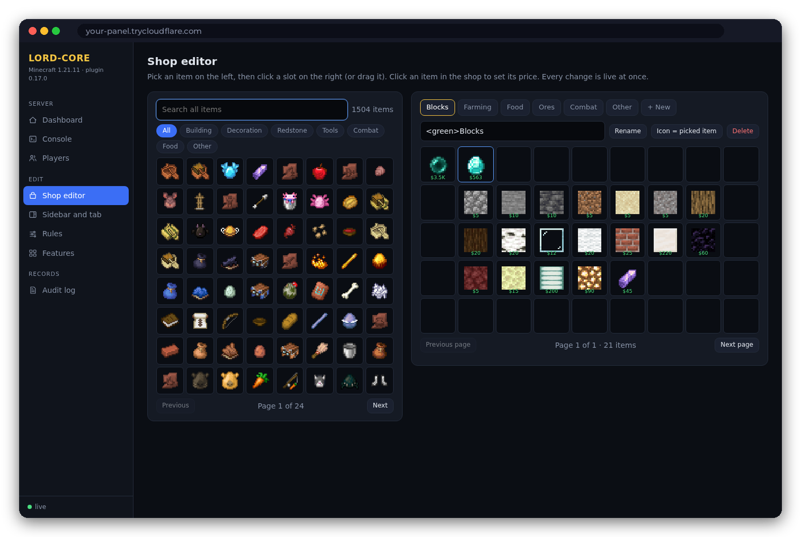 <b>Shop editor.</b> Categories, items and prices. | 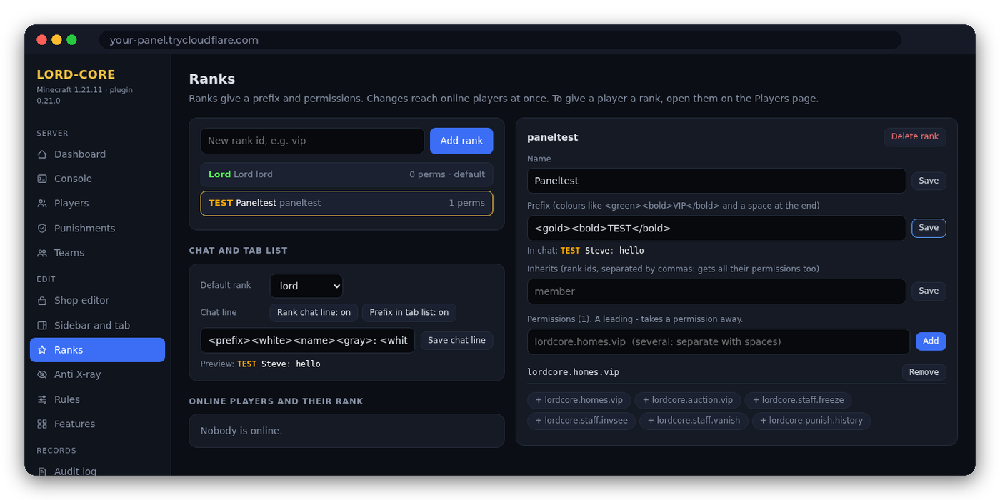 <b>Ranks.</b> Prefix with a live preview, permissions, inheritance. |
| 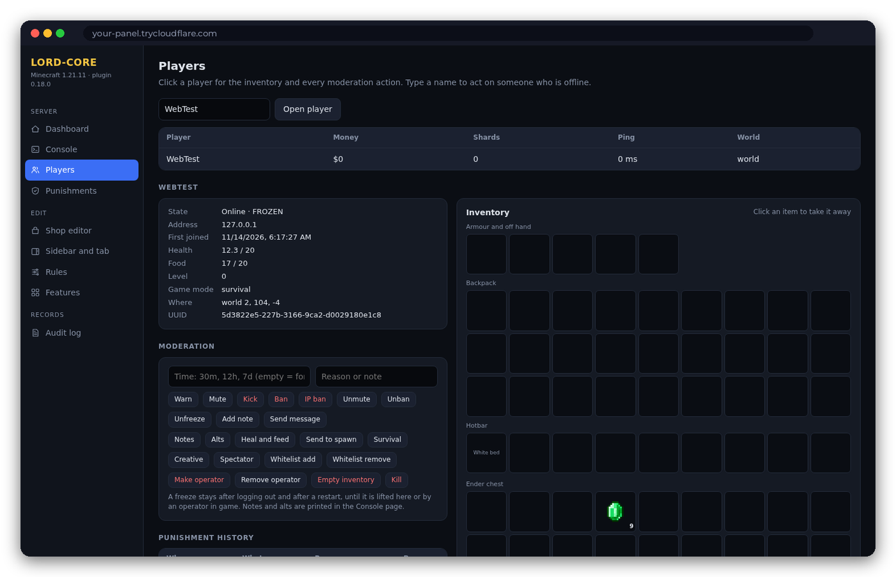 <b>Players.</b> Balance, rank, crate keys, freeze, kick, ban. | 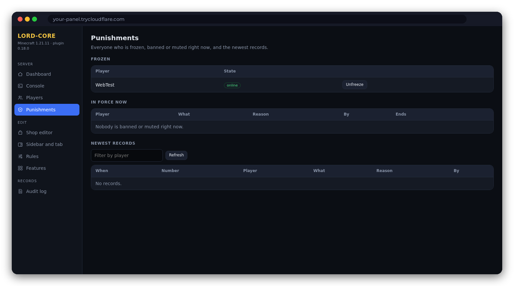 <b>Punishments.</b> Active bans and mutes, and each player's history. |
| 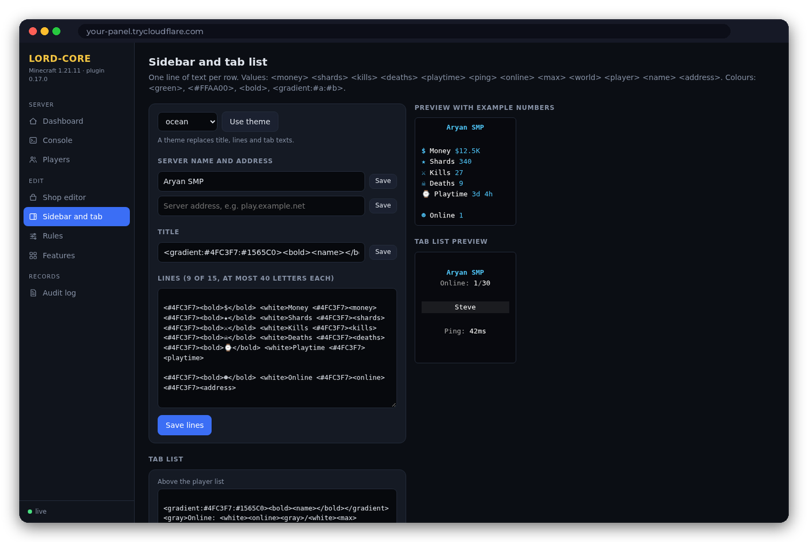 <b>Sidebar and tab list.</b> Themes and a line editor. | 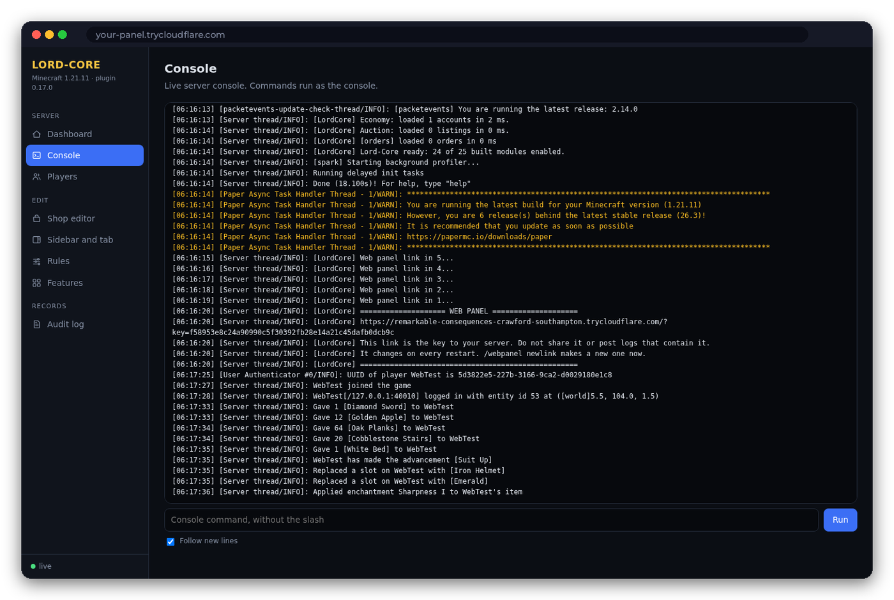 <b>Console.</b> Live log with filters, and a command line. |

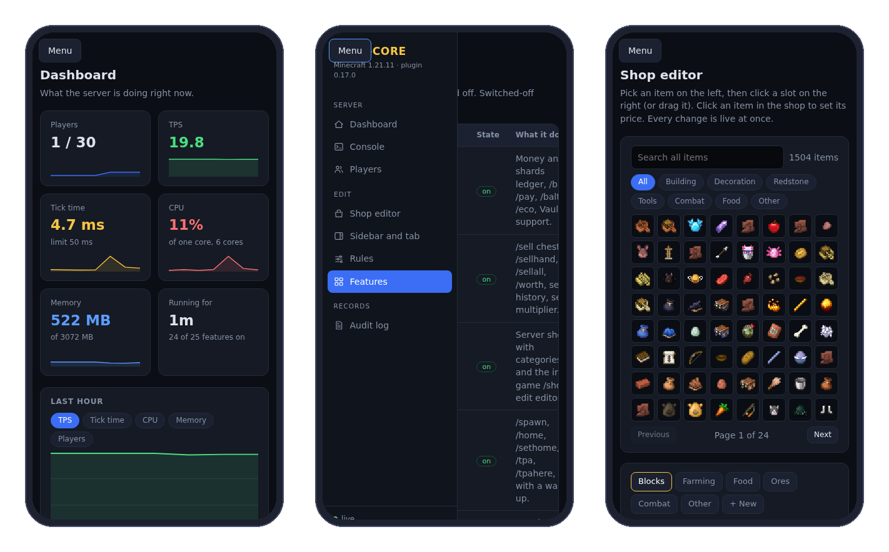

How it is kept private:

- The link contains a long random key. `/webpanel newlink` makes a new key and signs every browser out.
- The address changes each time the server restarts (that is how the free Cloudflare tunnel works). `/webpanel link` shows the current one.
- Everything done from the panel is written to the audit log.

Anyone who has the link controls your server, so treat it like a password.

## In-game control

| Command | What it opens |
|---|---|
| `/adminar` | The admin panel: features, rules, editors, players, economy, audit log, data |
| `/shop edit` | The shop editor |
| `/sidebar edit` | The sidebar and tab list editor, with ready-made themes |
| `/menuedit` | Rearrange the items of any screen |
| `/antixray` | Anti X-ray: level 1 or 2, per world (needs one restart to take effect) |
| `/webpanel link` | The link of the web panel |

## Contributing

Bug reports and feature requests are welcome in [Issues](https://github.com/hackerlemonaru/Lord-Core/issues). For a bug, please include the Lord-Core version, the Paper version and the error from the console.

## License

Lord-Core is free software under the [GNU General Public License v3.0](LICENSE). You may use, change and share it; if you share a changed version, it must stay under the same licence and its source must be available.

Not an official Minecraft product. Not approved by or associated with Mojang or Microsoft.
